# goksen.ing for Herdr

A Herdr layout in the goksen.ing look:

- bone on ink, with one red;
- square corners and Geist Mono;
- stepped motion.

## Add it

Ask the agent in Herdr to add `herdr.dev/layouts/dopplerDistortion/herdr-goksen`. To add it by hand:

1. Copy `layouts/goksen.json` and `layouts/goksen.svg` into `~/.config/herdr-app/layouts/`.
2. Copy `themes/goksen-ing.json` into `~/.config/herdr-app/themes/`.
3. Copy every `mods/g-*` folder into `~/.config/herdr-app/mods/`.
   Copy each folder's `mod.json` before its `main.js`.
4. Merge the `layout:goksen` section of `keys.json` into yours.
5. Run `herdr-app do layout.switch --name goksen`. `ctrl-shift-l` switches back.

To see every motion effect, open the palette (⌘⇧P) and choose "Motion specimen".

## Interactions

Recorded from the running app. Every step keeps its real length: frames were shot with the motion
slowed ×4, then played back ×4.

| | |
|---|---|
| **Agent needs you.** The agent turns blocked. Its tab, pane header and agent row cut to red. A toast comes up, and the status bar counts it. 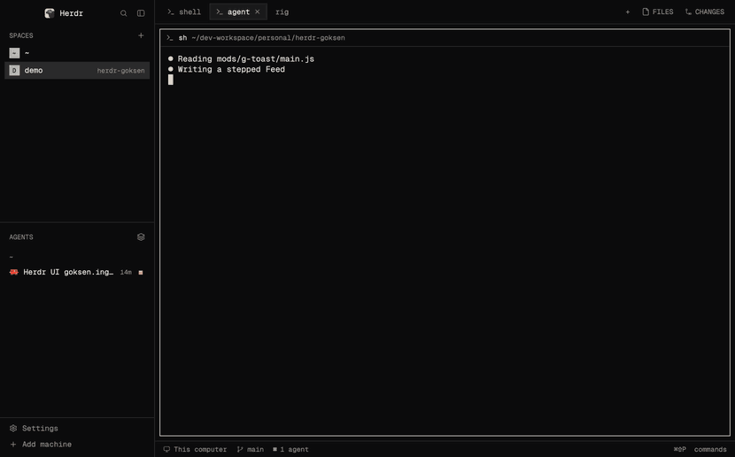 | **Toast.** An agent in another tab finishes. The toast feeds up from the bottom edge in 4 steps. 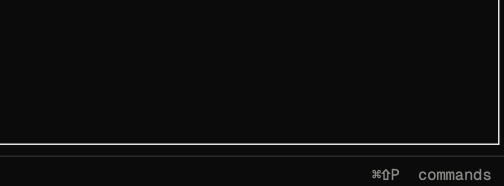 |
| **Command palette (⌘⇧P).** The focus ring snaps in and the rows step in. 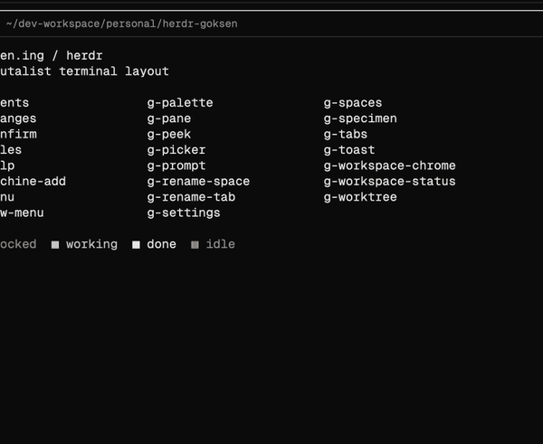 | **Go to (⌘P).** The rows step in. 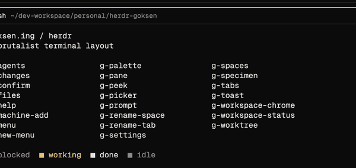 |
| **Settings (⌘,).** On the first open of a session, the dialog writes its own source, then builds part by part. 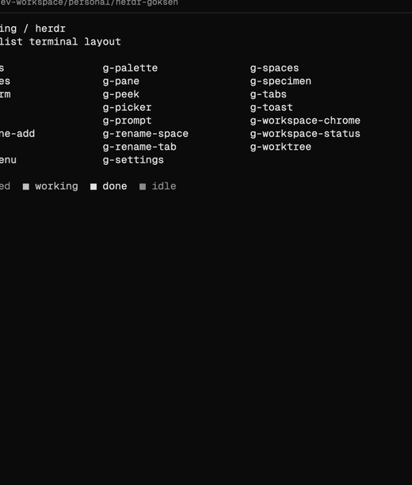 | **Rename tab (F2).** The title dissolves in and the field's focus ring snaps. 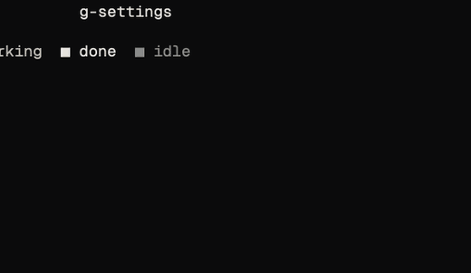 |
| **Keybinds (⌘/).** The title dissolves in. 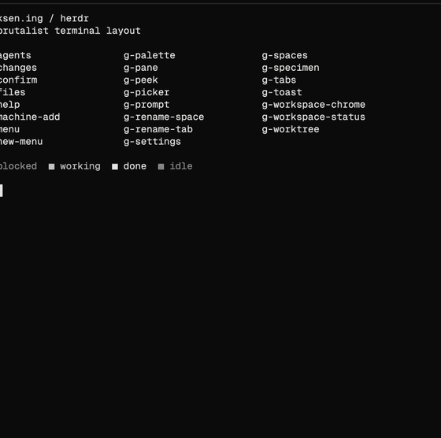 | |

## Motion

The ten effects in the motion specimen. Every one is stepped: there are no fades and no easing.

| | |
|---|---|
| **Busy · Scan · Cursor.** The endless marks: an amber square for work, a turning quarter block for search, the block cursor. 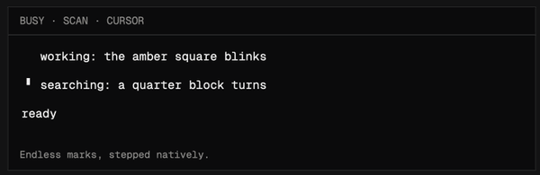 | **Glitch.** About a third of the characters swap to block glyphs for 240 ms. It runs on hover. 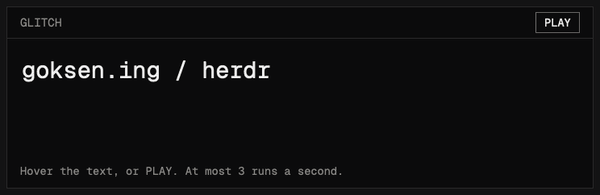 |
| **Dissolve.** The characters settle in random order, 300 ms. 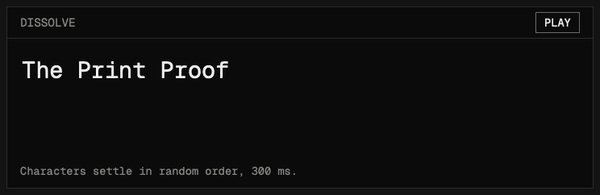 | **Step.** The rows appear one by one, 28 ms apart. 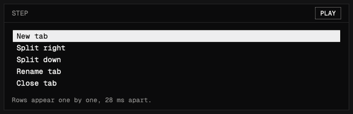 |
| **Feed.** A sheet comes up in 4 steps of 40 ms. 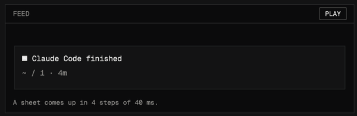 | **Hard cut.** Two cuts to red with a tear, 400 ms. 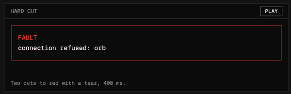 |
| **Aftershock.** After a fault, a jolt, a slice or an emote comes every 1.4 to 5.2 s. 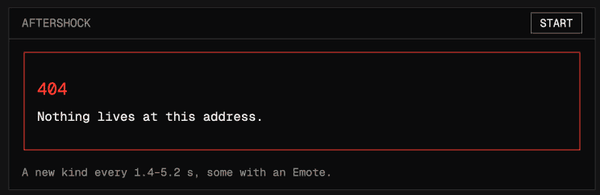 | **Boot log.** The status line types itself once per session, then the cursor blinks. 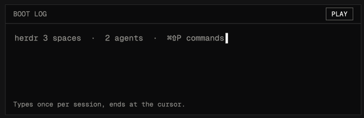 |
| **Build.** A panel writes its source, cuts to its frame, then builds each part. 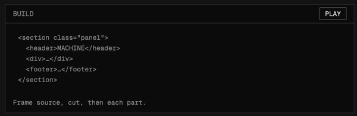 | **Focus snap.** The ring lands 2 px out, then closes in one 40 ms step. 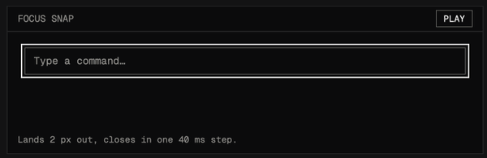 |

When macOS Reduce motion is on, every effect holds still.

To record them again, run `scripts/record.py`. See its header for how to use it.

## Change the motion

Edit `shared/motion.js`, then run `scripts/sync.sh`. The script copies the file into each mod that uses it.

See [RECIPE.md](RECIPE.md) for the full brief.

## License

Apache-2.0. The `g-*` mods include modified copies of mods that ship with Herdr. See [NOTICE](NOTICE).
