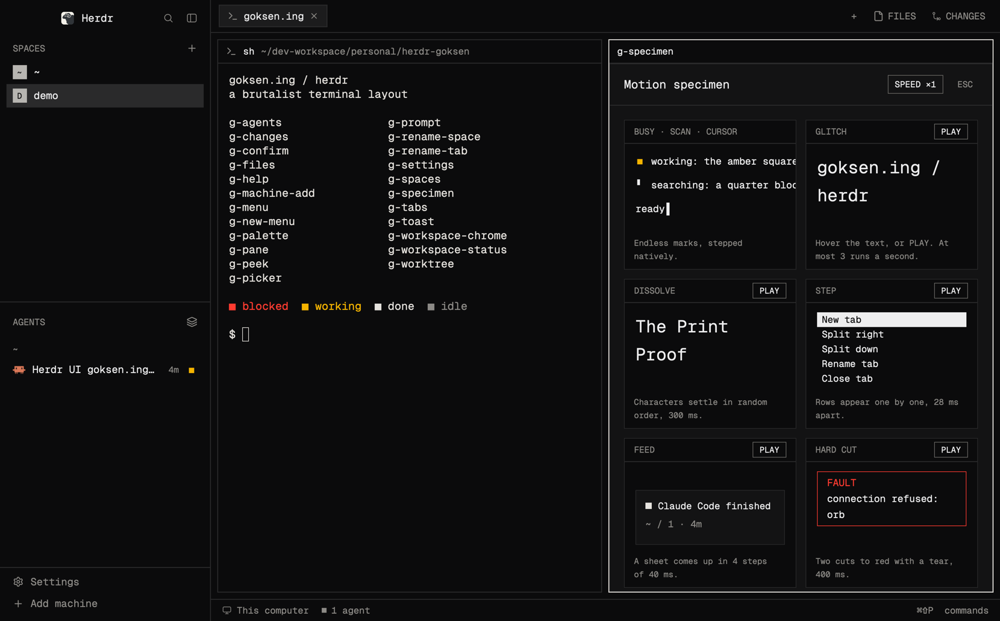

# goksen.ing for Herdr

A Herdr layout in the goksen.ing look:

- bone on ink, with one red;
- square corners and Geist Mono;
- stepped motion.

## Add it

Ask the agent in Herdr to add `herdr.dev/layouts/<owner>/herdr-goksen`. To add it by hand:

1. Copy `layouts/goksen.json` and `layouts/goksen.svg` into `~/.config/herdr-app/layouts/`.
2. Copy `themes/goksen-ing.json` into `~/.config/herdr-app/themes/`.
3. Copy every `mods/g-*` folder into `~/.config/herdr-app/mods/`.
   Copy each folder's `mod.json` before its `main.js`.
4. Merge the `layout:goksen` section of `keys.json` into yours.
5. Run `herdr-app do layout.switch --name goksen`. `ctrl-shift-l` switches back.

To see every motion effect, open the palette (⌘⇧P) and choose "Motion specimen".

## Change the motion

Edit `shared/motion.js`, then run `scripts/sync.sh`. The script copies the file into each mod that uses it.

See [RECIPE.md](RECIPE.md) for the full brief.

## License

Apache-2.0. The `g-*` mods include modified copies of mods that ship with Herdr. See [NOTICE](NOTICE).
