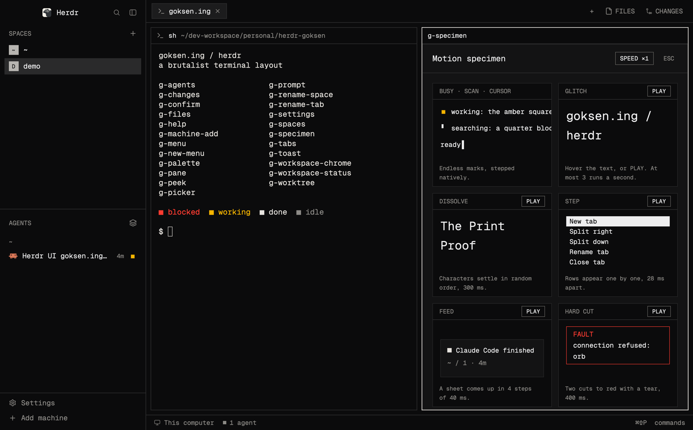

# goksen.ing

A brutalist terminal look for Herdr. Bone text `#e6e3de` on ink `#0b0b0c`,
one red `#ff3b30` for faults, one amber `#f5b400` for work. Square corners,
1px rules, Geist Mono everywhere, no shadows, no transparency. Every dialog,
menu and toast is restyled, and all motion is stepped: hard cuts, never fades.

## What you see

Left to right:

- **Sidebar**, 268px, color `chrome` (`#0b0b0c`). Top to bottom:
  - Brand row, 46px: the Herdr mark, "Herdr", search and fold buttons.
  - SPACES, then AGENTS. These two lists share the height equally, each at least 90px.
    Each space has a square letter tile.
    Each agent row shows its program icon, its name, its age and a status square.
  - Footer, 69px: "Settings" and "Add machine".
- **Work column**:
  - Tabs row, 42px. Each tab is a square box with `>_`, its name and `×`.
    On the right: `+`, FILES and CHANGES.
  - Body, 8px padding and gap:
    - Terminal panes. Each has a 30px header (`>_`, the program, the folder),
      a 1px `#2a2a2b` border and a bone border on focus. Radius 0.
    - Optional right panel, 368px, hidden at first: Files or Changes.
  - Status bar, 28px: machine, agent count, and `⌘⇧P commands` on the right.

Theme `goksen-ing`:

- Surfaces: `#0b0b0c` canvas, `#131314` popover, `#1c1c1d` hover, `#2a2a2b` border and selection.
- Text: `#8c8a86` muted, `#6b6a66` input rule.
- The accent is bone and the text on it is ink.
- Terminal ANSI colors stay in greys, plus red 1/9 and amber 3/11.

Labels are upper case micro-labels (SPACES, AGENTS, FILES). The selected row is
inverted: bone fill, ink text. Hover is a solid `#1c1c1d`, never opacity.

## How it behaves

- **Agent status:** working is an amber square that blinks in steps. Blocked
  is red, and the pane and agent badge "NEEDS YOU" arrive with a hard cut
  (two cuts to red with a tear, 400ms). Done is a bone square. Idle is grey.
- **Motion vocabulary**, all stepped:

  | Effect | What it does | Where it is used |
  |---|---|---|
  | Busy | Blinking square | Working agents |
  | Scan | A quarter block turns | Loading lists |
  | Cursor | Block cursor, 1000ms | Prompts |
  | Glitch | About a third of the characters swap to block glyphs for 240ms. At most 3 runs a second. | Hover on tab names, space names, buttons and footer rows |
  | Dissolve | Characters settle in random order, 300ms | Dialog titles and the "Herdr" brand |
  | Step | Rows appear one by one, 28ms apart | Menus and lists |
  | Feed | The sheet comes up in 4 steps of 40ms | Toasts |
  | Hard cut | 80/60/80/80/100ms | Faults. An error toast cuts 200ms after its Feed. |
  | Aftershocks | A new jolt, slice or emote every 1.4 to 5.2s, until it is cleared | After a worktree fault |
  | Boot log | The status bar types `herdr N spaces · N agents · ⌘⇧P commands`, then the cursor blinks 5 times | Once per session |
  | Build | The dialog writes its own source, cuts to its frame, then each part | Settings, first open per session |
  | Focus snap | A focus ring lands 2px out, then closes in one 40ms step | Inputs |

- **Reduce motion:** when macOS Reduce motion is on, every effect holds still.
- **Keys** (layout only, `keys.json` section `layout:goksen`):

  | Key | Opens |
  |---|---|
  | ⌘P | Go to space or tab |
  | ⌘⇧P | Command palette (recent first, grouped, keybinds shown) |
  | ⌘/ | Keybinds |
  | F2 | Rename tab |
  | ⇧F2 | Rename space |
  | ⌘, | Settings |

- Right-click a terminal: the `g-menu` menu. Rename goes to the restyled
  prompt, Close space goes to the restyled confirm, and Help goes to `g-help`.
- Palette → "Motion specimen" opens a dialog with every effect and a PLAY
  button. SLOW ×4 makes the steps readable.
- The GIFs in `docs/motion/` show each effect and the main dialogs.

## Built from

- `layouts/goksen.json`, a clone of the shipped `main` layout:
  - Root keys: `theme: "goksen-ing"`, `font` and `ui_font: "Geist Mono"`, `terminal_padding [14, 12]`,
    `titlebar: "none"`, `terminal_menu: "g-menu"`, `toast: "g-toast"`, `preview: "layouts/goksen.svg"`.
  - Tree: sidebar column (`g-workspace-chrome`, `g-spaces`, `g-agents`,
    `g-workspace-chrome {footer: true}`), then a work column (`g-tabs`, the
    active tab with `g-pane` headers, a hidden stack panel with `g-files` and `g-changes`, then `g-workspace-status`).
- `themes/goksen-ing.json`: required. The layout names it.
- `mods/g-*`, 23 folders:
  - 18 are `mod.clone`s of shipped mods: agents, changes, confirm, files, help, machine-add,
    menu, new-menu, pane, peek, picker, prompt, spaces, tabs, toast, workspace-chrome, workspace-status, worktree.
  - 5 are new: `g-palette`, `g-rename-tab`, `g-rename-space`, `g-settings`, `g-specimen`.
  - Overlay mods have `"frame": "none"` in `mod.json` and draw their own square 1px frame.
  - The mods open each other by name, so install all of them.
- `shared/motion.js` is the one source of the motion. Mods cannot import across
  folders, so `scripts/sync.sh` copies it into each mod that imports `./motion.js`.
  - `Motion.play` chains `cx.timer.after` steps, one redraw per step, each with its own `cx`.
  - `.transition` and `.loop` are not used, because they only ease.
  - Endless marks use native `.frames()`.
  - Every step length is multiplied by `Motion.factor()`. That is the view's own `scale`
    times shared `"g.motion.scale"`, which defaults to 1.
- `g-specimen` props are for recording:
  - `only` (a panel label) shows one panel, 560px wide.
  - `autoplay` (ms) replays that panel.
  - `slow` starts the view at ×4.
  - `scale` sets shared `"g.motion.scale"` for every mod. Set it to 1 to clear it.
  - Open it with `tab.new {mod: "g-specimen", props}`.
- `scripts/record.py` turns `herdr-app shot` bursts into GIFs with ffmpeg:
  - It scales each shot to 1660px wide and crops it.
  - It drops frames that did not change.
  - It plays the frames back `speed` times faster than they were recorded.
- Programs it runs:
  - `git`, `sh`, `open`, `powershell` and `hc` are inherited from the shipped mods.
  - New in this layout: `ls <home>/themes` (palette, settings) lists the theme names.
  - New in this layout: `defaults read com.apple.Accessibility ReduceMotionEnabled` (workspace-chrome)
    runs once a minute and stores `"reduce"`/`"full"` in shared `g.motion`.
  - No mod reaches the network.
  - Files and Changes read the space's folder, as the shipped panels do.
    The new code reads nothing else outside the Herdr home.

## Watch out

- Write `mod.json` before `main.js` in a new mod folder. Otherwise Herdr can
  dock the new mod into the open layout.
- A new mod folder needs 1 to 2 seconds to load before `mod.open` finds it.
- Never keep a `cx` across timer steps. Use the one each callback gets.
- Build starts one timer tick after the first render. Keep the dialog
  invisible until that tick, or the finished dialog flashes for one frame.
- `herdr-app shot` comes at 1x or 2x, and the size can change between two
  shots. Scale every frame before you crop it.
- A terminal opened with `argv` still starts through the login shell. Its
  startup output (for example oh-my-zsh warnings) shows before the program.
  Clear the screen first, or record from after the clear.
- `terminal.right_click` is a setting, not a click. Menus that need a real
  click (the terminal menu, `+`) cannot be opened by a script.
- The Reduce motion probe is macOS only. On other systems, `defaults` fails and motion stays on.
- `g-palette` reads keybinds from `layout:goksen`. If you rename the layout, rename that section too.
- Still drawn by Herdr, not restyled:
  - the sections behind Settings → "All settings";
  - the machines settings opened from the spaces list;
  - peek opened from terminal address links;
  - the terminal cursor blink;
  - the dialog open animation.
- The API has no letter-spacing and no crop marks, so the site's tracking and corner marks are not here.

## Done when

- `herdr-app check mods/<name>` passes for all 23 mods. Warnings that a mod
  ran `ls`, `defaults` or `hc` are expected.
- `layout.switch {name: "goksen"}` shows ink chrome, square tabs and Geist
  Mono, and `herdr-app status` lists no errors.
- ⌘⇧P opens the palette: its rows step in, and its input field snaps its focus ring.
- The first ⌘, of a session builds Settings from its source. The second opens at once.
- On a fresh launch, the status bar types its boot line once.
- With Reduce motion on, the specimen says so and no effect runs.
